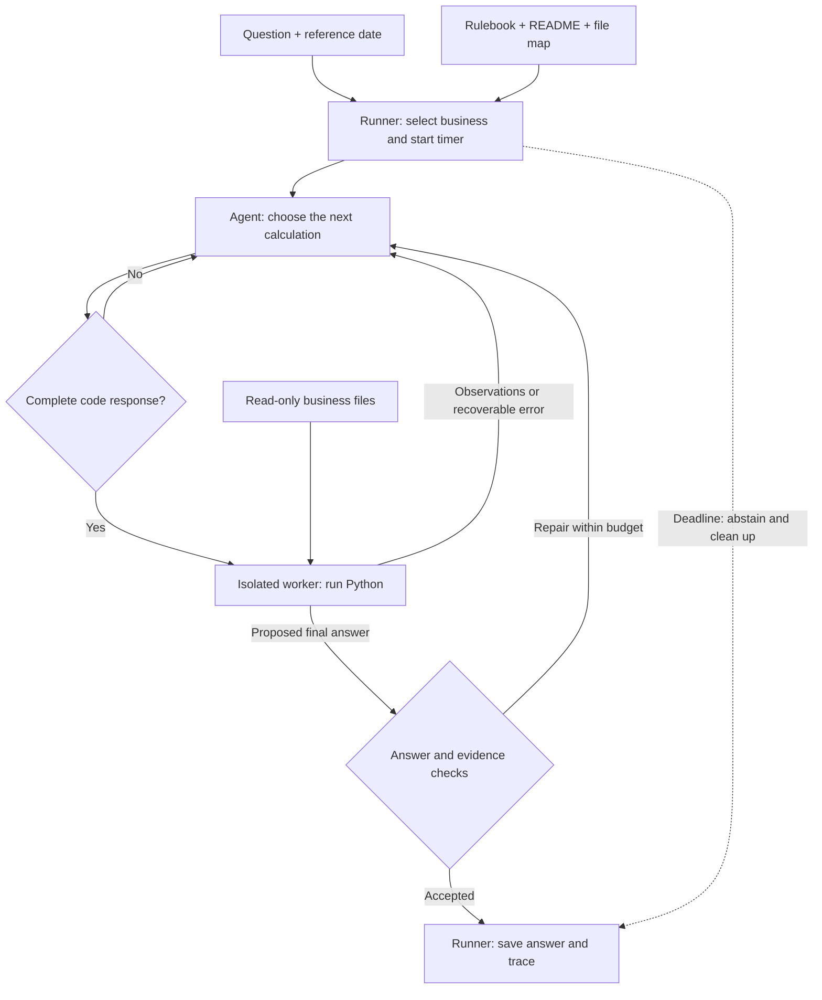
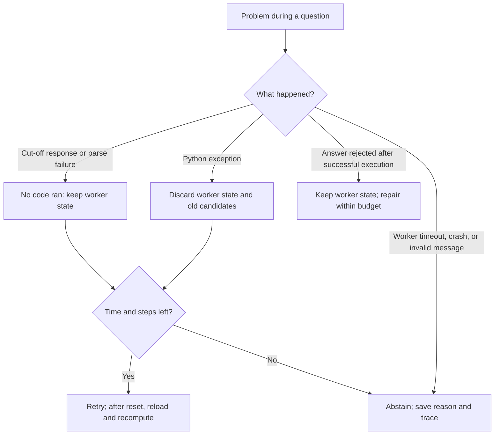

# Understanding and debugging the agent

Think of the system as a junior data analyst with a Python calculator. The analyst chooses what to calculate; Python performs the calculation; your application controls access, checks the output, and saves the result.

**Status — 3 November 2026:** the native agent core is implemented. This guide follows that code and the [rewrite design](smolagents-rewrite-plan.md). Real-worker checks cover execution and recovery; representative answer quality and the final deployment environment still need evaluation. The previous controller is preserved in a local snapshot.

Read the next three parts for the main idea. Use the debugging tables when investigating a run.

## What each part knows

| Input | Plain meaning | Example |
| --- | --- | --- |
| Question and `as_of_date` | What to answer, and what “today” means | “Last week” is relative to this date, not your computer's date. |
| Current split's `rulebook.md` | How to interpret business terms | “Best selling” means quantity in base units; exclude cancelled and returned orders. |
| Business `README.md` | How this business stores its information | Sales are spread across monthly sheets; unit conversions are in another file. |
| CSV, XLSX, SQLite files | The actual records to calculate from | Orders, quantities, payments, stock movements. |
| `calendar.csv` | Date mapping for lunar periods | Find the solar dates of the specified Tết window. |

The model receives instructions, file descriptions, and small observations. The worker reads the full relevant tables. A preview helps locate data; it is not enough to calculate a total or prove that information is absent.

## How one question travels

This diagram shows the implemented path. “Agent” means CodeAgent coordinating calls to one local language model.



| Part | Its responsibility | What it cannot establish by itself |
| --- | --- | --- |
| Language model | Interpret the question and write Python | That its interpretation is correct. |
| CodeAgent | Repeat “choose action → observe result → continue” | That a successful calculation answers the question. |
| Worker | Execute Python in a restricted process | Whether the chosen metric or business rule is right. |
| Validators | Reject malformed answers and detectable evidence problems | Complete semantic correctness. Model-written evidence can also be wrong. |
| Runner | Choose inputs, enforce deadlines, clean up, and write results | Answer quality without evaluation. |

The model server lives outside the worker. Generated code should have no network access and cannot modify source data or write submissions. Training reference answers are available only to the scorer after prediction, outside the agent's context and worker.

## Follow a tiny example

Question: **“Tuần rồi mặt hàng nào bán chạy nhất?”** Reference date: **2026-03-04**.

The correct interval is **23 February through 1 March**, the previous Monday–Sunday week. That crosses a month boundary, so relevant data may be in two sheets.

These records are invented for this explanation. Assume each row belongs to a different order and the business README says one box contains 12 bottles.

| Date | Product | Quantity | Order status | Counted bottles |
| --- | --- | --- | --- | --- |
| 24 February | Trà đóng chai | 2 boxes | Completed | 24 |
| 1 March | Trà đóng chai | 3 bottles | Completed | 3 |
| 25 February | Nước cam | 40 bottles | Returned | 0 |
| 26 February | Nước suối | 60 bottles | Cancelled | 0 |

The agent must read both sheets, exclude the returned/cancelled orders, apply the conversion, and group by product. Trà đóng chai has 27 eligible bottles and wins. The runner would write:

```json
{"id":"example_question","type":"string","answer":"Trà đóng chai"}
```

This gives you concrete debugging clues: **24** suggests a missing March sheet; **5** suggests missing unit conversion; choosing Nước cam or Nước suối suggests a status-filter error. All of those mistakes can occur without Python raising an exception.

## What happens when something goes wrong

Variables and loaded tables persist between successful actions in one question. A new question starts a fresh worker. Real-worker tests cover this behavior and the reset boundaries below.



Why discard state after an exception? Imagine code doubles a quantity, then crashes. Retrying against the changed table could double it again. A fresh worker avoids carrying that partial calculation forward. Its new session number also lets the runner reject an answer saved before the reset.

The final outcomes have different meanings:

| Outcome | Meaning |
| --- | --- |
| A normal typed answer | The system accepted a result. It may still be semantically wrong. |
| `unanswerable` | The available data cannot support the answer, established by inspecting relevant sources. |
| `abstain` | The system stopped without an accepted answer: uncertainty, failed execution, or exhausted budget. |

An empty filtered table does not automatically mean “unanswerable.” First check date parsing, filters, and coverage. No sales during a covered period can mean zero; a period wholly outside the available coverage is different.

## Debug one question, from evidence to cause

Start with the saved run's `trace.html`. Click a question, then expand its code and observations. For a deeper inspection, use the artifacts from the [runner](README.md#what-to-inspect-when-debugging).

| Open | What to look for |
| --- | --- |
| `trace.html` | Expand the ordered actions, observations, validation errors, and resets without typing commands. |
| `report.json` | Which questions were wrong or abstained in a training benchmark? Was the run incomplete? Prediction-only runs have no correctness score. |
| `questions.jsonl` | Exact question, business routing, and reference date. |
| Matching file under `logs/` | Match the `id` inside the file. Filenames such as `000000.json` are sequence numbers, not question IDs. Read events in order. |
| `config.json` | Which model, source version, rules, and settings produced this run? |
| `submission.jsonl` | The exact final answer that was written. |

In JSON traces, inspect `events`. `model_step` records the generated response and completion status; `code` and `observation` show what actually ran. `validation`, `worker_reset`, and `stop` explain why it repaired or stopped. Incremental `.events.jsonl` files retain observations even when a question is interrupted.

For each action, ask: **What did it try? What code ran? What did the worker report? Why did it continue or stop?** Find the first incorrect step; later mistakes may only be consequences.

| Symptom | First evidence to inspect | Likely place to investigate |
| --- | --- | --- |
| Wrong week or month | Planned start/end dates and actual code filter | Question interpretation or date parsing. |
| Total too low | Opened sheets, row counts, eligible statuses | Missing input or incorrect filters. |
| Total too high | Unit conversion, duplicate rows, join row counts | Repeated conversion or a join duplicating transactions. |
| “Missing data” despite visible records | Full-source coverage and parse failures | Preview-only reasoning or an empty selection caused by bad parsing. |
| Correct value rejected | Validator message and declared answer type | Output shape, rounding, or evidence mismatch. |
| Repeated errors or slow answer | Sequence of code actions and observations | Unsuccessful repair, repeated reads, or excessive generation. |

If a needed fact is absent from the log, record it as unknown. Add that observation in the next implementation change rather than guessing what happened. Current traces include worker session numbers, completion status, elapsed time, and rejection reasons; they do not yet show a separate remaining-budget counter.

## Where you have control

| Control | Code to inspect | Responsibility |
| --- | --- | --- |
| Files, sheets, headers, dates, numbers, joins | [tools.py](tabular_agent/tools.py), [data_tools.py](tabular_agent/data_tools.py) | Explicit readers and diagnostics. |
| Instructions and next-step behavior | [agent.py](tabular_agent/agent.py) | Native construction, focused prompt, and small framework hooks. |
| Isolation, execution, cleanup | [executor.py](tabular_agent/executor.py), [worker.py](tabular_agent/worker.py) | Worker lifecycle and execution. |
| Answer/evidence checks | [contracts.py](tabular_agent/contracts.py), [evidence.py](tabular_agent/evidence.py) | Strict answer shapes and current-session evidence. |
| Model connection and time budgets | [model.py](tabular_agent/model.py), [runner.py](tabular_agent/runner.py), [runtime.py](tabular_agent/runtime.py) | Local requests, deadlines, and outputs. |
| Score and evaluation groups | [evaluate.py](tabular_agent/evaluate.py), [splits.py](tabular_agent/splits.py) | Internal scoring and stable business partitions. |

The current defaults are **8 actions, 2,048 generated tokens per call, 30 seconds per code action, and 180 seconds per question**. These are starting experiment settings. More time can help a valid repair, but cannot fix a wrong rule. Use the [command documentation](README.md#commands) for available options.

To change the system while keeping control:

1. Save the failing trace and configuration. Reproduce a mechanism bug with tiny invented data where possible.
2. State one hypothesis: for example, “only the first monthly sheet was loaded.”
3. Change the responsible reader, instruction, or check; keep other settings fixed.
4. Verify the specific failure, then compare old and new predictions on the same frozen validation questions with the same scorer. Keep reference answers out of inference.

For a synthetic illustration, 6 correct, 2 wrong, and 2 abstained answers give **PA = (6 − 2) / 10 = 0.40**, **coverage = 8 / 10 = 80%**, and **answered accuracy = 6 / 8 = 75%**. Track all three: answering more can increase errors, while abstaining on everything gives no useful answers. Keep untouched businesses for the final check after choices are frozen.

The first implementation checkpoint is the tiny question path above, plus failure and isolation checks. The user explicitly requested proceeding without running the old agent: its source was preserved, and no new old-agent baseline was measured. The [remaining gates](smolagents-rewrite-plan.md#8-ordered-milestones-and-acceptance-gates) still require real-model quality and deployment verification before adoption.
