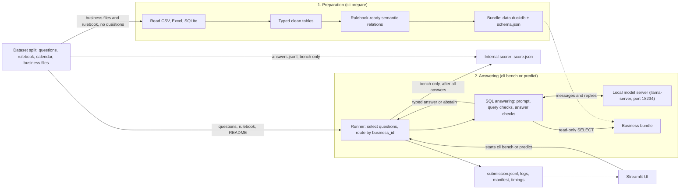

# The big picture

The system works in two stages. **Preparation** turns each business's files into a DuckDB bundle, without reading questions or answers. **Answering** lets a local model query that bundle with SQL and checks every query and answer in code.

**Who starts what.**

- `predict.sh` (the submission entrypoint) starts the model server, runs preparation into a work folder while the model loads, then runs `cli predict` over those bundles.
- For development, `make prepare` writes bundles once under `artifacts/`; `make serve` starts the server; `make bench`, `make predict` and the UI answer over existing bundles.
- The runbook's measurements use `scripts/bench-local.sh`, which starts a fresh server for each set.

| Component | Input | Output |
|---|---|---|
| Preparation (`preparation/`) | One business's files, the split's rulebook and calendar | A content-addressed bundle; a report of blocked tables and issues. A business whose sales cannot be made rulebook-ready gets no `semantic.eligible_sales_lines` |
| Runner (`cli.py`) | Split, bundle folder, selection and run settings | Per-question answers, logs and timings; `abstain` when a business has no bundle, on a deadline or on an error |
| SQL answering (`sql_agent.py`) | Question, `as_of_date`, rulebook, business README, bundle | A validated typed answer, or `abstain` ([one question](02-question-flow.md)) |
| Model (`model.py`) | Chat messages | One reply per step, at temperature 0; a truncated reply raises an error |
| Scorer (`evaluate.py`) | Questions, predictions, reference answers | `score.json`: correct, wrong, abstain, penalized accuracy. Internal, not the official evaluator |

The hosted OpenAI provider can replace the local server for development; it needs network access and does not fit an offline profile.

Source: [cli.py](../../tabular_agent/cli.py), [sql_agent.py](../../tabular_agent/sql_agent.py), [preparation/](../../tabular_agent/preparation/), [predict.sh](../../predict.sh), [streamlit_app.py](../../streamlit_app.py).
