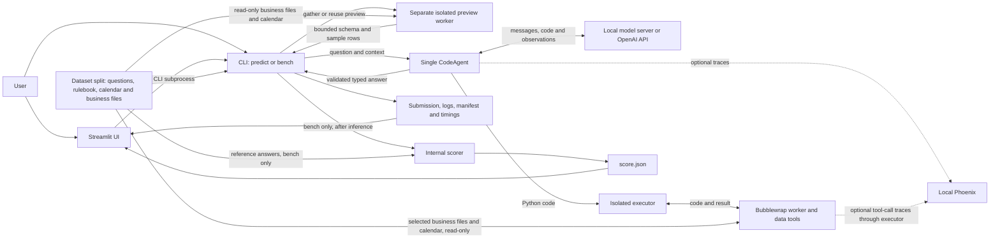

# The big picture

Think of the agent as an analyst: it receives a question and a rulebook, writes Python to examine the business files, and returns a typed answer. A model decides what code to write; a separate isolated worker runs that code.

The rulebook supplies business meaning, the business README explains its files, and the files contain the records. The question's `as_of_date` supplies the reference date. The hosted API is an optional development provider and requires network access; it does not satisfy an offline-only evaluation profile.

Each question uses one CodeAgent and its own isolated execution worker. Before solving, a separate worker gathers a bounded source preview; unchanged business previews are reused during the run. The single-agent design aims to reduce model calls and latency. Neither the under-10-second target nor real-model accuracy is established.

Source: [agent.py](../../tabular_agent/agent.py), [cli.py](../../tabular_agent/cli.py), [streamlit_app.py](../../streamlit_app.py), [telemetry.py](../../tabular_agent/telemetry.py).
