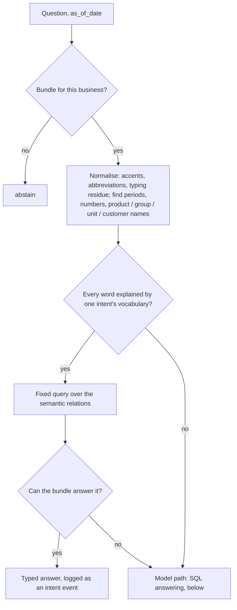
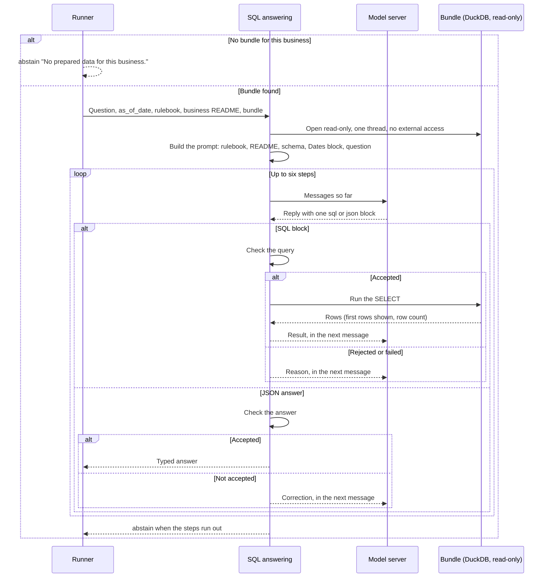

# What happens to one question

The runner first lets the fixed question kinds try the question (`answer_by_intent` in `cli.py`, kinds in `tabular_agent/intents/`). The attempt opens the bundle, closes it again, and either returns a typed answer without any model call or returns nothing. Only then does `answer_question_sql` in `sql_agent.py` answer over the same bundle. The runner gives the model path at most six steps (model calls) and 60 seconds.

Recognition is deliberately strict. A word that no intent explains (a qualifier such as "trừ voucher", a name the bundle does not hold) sends the question to the model, because a wrong answer costs more than the model's attempt. An intent answers `unanswerable` only when the asked period lies outside the sales dates, or when the bundle has rulebook-ready orders and nothing in its sources looks like the channel, payment method or customer the question needs.

**The prompt.** The schema lists the `semantic` relations first, with query patterns for the relations this bundle has, then the `clean` tables. Label columns with at most 12 short values show those values. The Dates block turns the rulebook's relative periods ("hôm qua", "tuần trước", "tháng này" …) into explicit date ranges computed from `as_of_date`, never from the system date. Date phrases found in the question are repeated with their dates.

**Query checks** (`check_query`), each rejection is sent back as feedback:

- exactly one `SELECT`, parsed by DuckDB; no table functions except the published period functions; no catalog-qualified names;
- only relations in the schema; private audit tables are not listed;
- no system date (`current_date`, `now()` …) and no `LIKE`: names are matched with `name_like(column, 'text')`, which ignores case and accents;
- sales tables that preparation could not make rulebook-ready are refused, with an instruction to abstain or to use `semantic.orders`.

**Answer checks**, applied in code rather than left to the model:

- The answer must parse as a typed answer; numeric text becomes a number, and a one-row table of numbers becomes a list.
- An answer before any successful query is not accepted.
- `unanswerable` is accepted only when the asked period lies entirely outside the bundle's sales dates. After a second unverifiable `unanswerable`, the result is `abstain`.
- A number must be a value of the last query result. After a second ungrounded answer, the result is `abstain`.
- A percent for a question that asks for an amount or a count gets one correction. A number for a question that asks for a percentage becomes a percent.
- `abstain` is always accepted.

A reply holding both a query and an answer is read as the query, because the answer was written before its result was seen. On the last step the model is told to answer now.

**What this does not guarantee.** The checks catch malformed, ungrounded and unverifiable answers. They cannot show that the query selected the right rows or applied the rulebook correctly.

Source: [sql_agent.py](../../tabular_agent/sql_agent.py), [cli.py](../../tabular_agent/cli.py). The reasons for each rule are in the [fix records](../fix/README.md).
