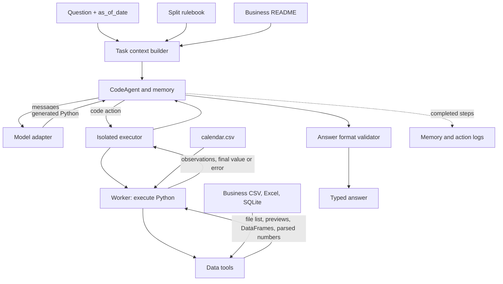

# Components and their inputs and outputs

| Component | Input | Output / responsibility |
| --- | --- | --- |
| Runner (`cli.py`) | Split, selection and run settings | Creates context per question, saves predictions and logs; optionally scores afterward |
| Agent (`agent.py`) | Question, date, rulebook, business README, model and tool descriptions | Coordinates model and code execution; requests a typed final answer |
| Model (`model.py`) | Agent messages | Generated code or final-answer action; connects to a local server or hosted API |
| Executor and worker (`executor.py`, `worker.py`) | Python code and read-only business files and calendar | Executes code in a bubblewrap process and returns observations, result or error |
| Tools (`tools.py`) | File names or aliases, sheet/table names, values and number formats | Lists files, previews structures, reads tables or workbooks, and parses numbers |
| Validator (`contracts.py`) | Answer dictionary | Checks and normalizes the supported type and value shape; does not verify business correctness |
| Memory and telemetry | Agent steps and optional tool calls | Local inspection logs; optional Phoenix traces |
| Scorer (`evaluate.py`) | Questions, predictions and reference answers | Internal matching and score report, not an official evaluation |

The worker sees the selected business directory as `/data` and the calendar as `/calendar.csv`; both are mounted read-only. Its writable scratch directory is separate. The rulebook and README enter the model context, while the business files are read by code in the worker. Tool previews are samples, not complete reads.

Supported answer types: `number`, `percent`, `string`, `date`, `boolean`, `list`, `table`, `unanswerable`, and `abstain`. `unanswerable` means the data cannot support an answer; `abstain` means the system chooses not to answer.
