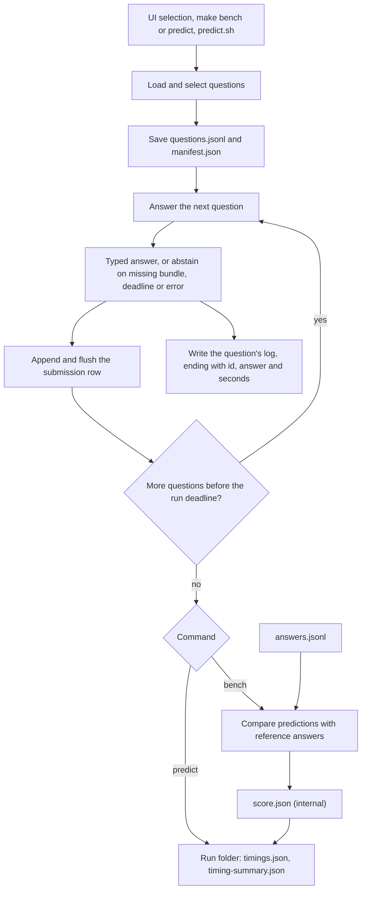

# Runs, outputs and scoring

A run folder holds:

| File | Written | Content |
|---|---|---|
| `questions.jsonl` | at the start | The selected questions, in the order they run (file order) |
| `manifest.json` | at the start | Commit and whether the tree was dirty, dependency versions, model, server URL, bundle folder, temperature, steps, and the weight digest and server settings passed by the launcher |
| `submission.jsonl` | after each question | `{"id", "type", "answer"}` or an abstention with its reason |
| `logs/NNNNNN.jsonl` | during each question | Stages `schema`, `memory_step` (model reply and token usage), `sql`, `observation`, and last `question_timing` |
| `timings.json`, `timing-summary.json` | at the end | Seconds, model calls and tokens per question; nearest-rank p50, p90, p95 and the share under 10 seconds, also for answered and abstained questions apart |
| `score.json` | at the end, `bench` only | Correct, wrong, abstain, penalized accuracy, coverage, answered accuracy, and the outcome of each question |

An interrupted run keeps every answer and log written so far; the timing files and the score are missing. If the run deadline is reached, the remaining questions are not written.

Reference answers are read only after all questions are answered, and never enter the model's context. The scorer is an internal approximation; its numbers do not establish an official score. A run is comparable with another only under the conditions of [the runbook](../fix/RUNBOOK.md): temperature 0, a fresh server per set, a pinned worktree, and the same bundles.

Source: [cli.py](../../tabular_agent/cli.py), [evaluate.py](../../tabular_agent/evaluate.py), [streamlit_app.py](../../streamlit_app.py).
