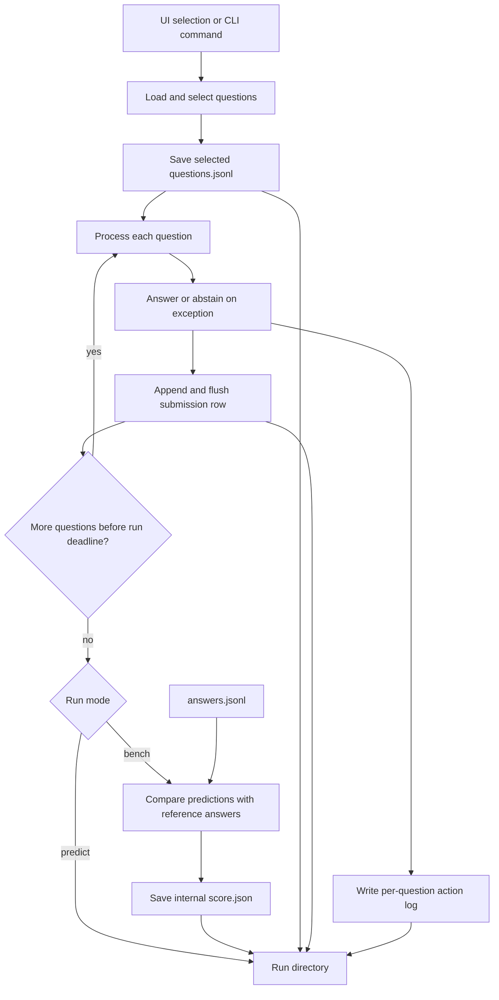

# Runs, outputs and scoring

A completed run directory contains the selected `questions.jsonl`, `submission.jsonl`, `logs/`, `manifest.json`, `timings.json`, and `timing-summary.json`; a benchmark also produces `score.json`. Submission rows and logs are written as questions finish; timing files and the score are written after processing, so an interrupted run can contain only a subset. In benchmark mode, reference answers are loaded for scoring after inference, rather than included in the agent's task context. The UI chooses benchmark mode when the split has `answers.jsonl`, otherwise prediction mode.

The timing summary reports nearest-rank p50, p90 and p95 and the share under 10 seconds, including separate shares for answered and abstained questions. File-read time is part of execution time. The internal score reports correct, wrong, abstained, penalized accuracy, coverage and answered accuracy; answered accuracy is null when there are no answered questions.

The scorer is an internal approximation. Its result does not establish an official score or real-model answer quality. Optional Phoenix tracing is separate from the saved run files and may contain business information.

Source: [cli.py](../../tabular_agent/cli.py), [evaluate.py](../../tabular_agent/evaluate.py), [streamlit_app.py](../../streamlit_app.py).
