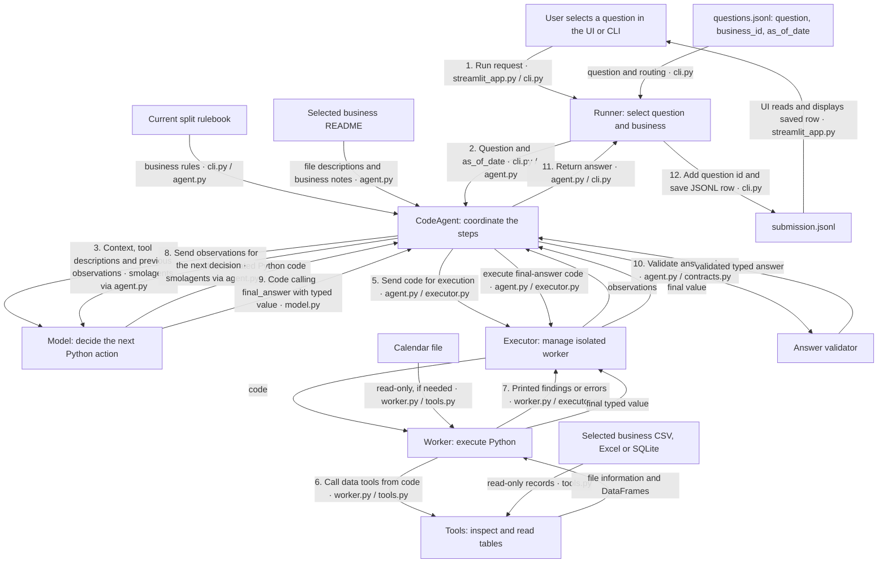

# How the components work together to produce an answer

This shows the **single-agent architecture** using an **illustrative** question: “What was the total quantity sold last week?” The exact files, rules, code, and numeric result depend on the selected business and split. No calculation below is an observed run.

The model and worker may exchange several actions and observations through the agent before reaching step 9. For example:

1. The runner selects a question and uses its `business_id` to locate the business files. It gathers a bounded source preview in a separate isolated worker, or reuses the cached preview for unchanged business files, and sends it with the question, `as_of_date`, current rulebook and business README to the agent.
2. The model may first write code using `list_files()` and `inspect_table()` to discover which files and columns are relevant. The worker runs it; printed findings return to the agent and then to the model.
3. The model may then write code using `read_table()` to load the relevant records, apply the question and rulebook, and calculate a quantity. For a relative date such as “last week”, the task instructs it to use `as_of_date`. The calendar is available when needed.
4. Once ready, the model writes code calling `final_answer`, for example `final_answer({"type": "number", "answer": 42})`. **42 is only an illustrative value.** The worker returns the value, the agent checks its format, and the runner adds the question ID and writes a JSONL row such as `{"id":"example", "type":"number", "answer":42}`.
5. If the worker reports an error, it is reset and later code must reload data. The model can try another step within its budget. If an exception reaches the runner or the step limit is reached, the system can return `abstain` instead.

The UI and CLI are alternative entry points: the UI starts the CLI and displays its saved results. Logs and optional traces record the run for inspection; they do not calculate the answer. In benchmark mode, the internal scorer compares saved predictions with reference answers **after inference** and produces a separate report.

The validator checks the answer's type and shape. It cannot establish that the model selected the right records, applied the rulebook correctly, or computed the right value.

Source: [streamlit_app.py](../../streamlit_app.py), [cli.py](../../tabular_agent/cli.py), [agent.py](../../tabular_agent/agent.py), [executor.py](../../tabular_agent/executor.py), [worker.py](../../tabular_agent/worker.py), [tools.py](../../tabular_agent/tools.py), [contracts.py](../../tabular_agent/contracts.py).
