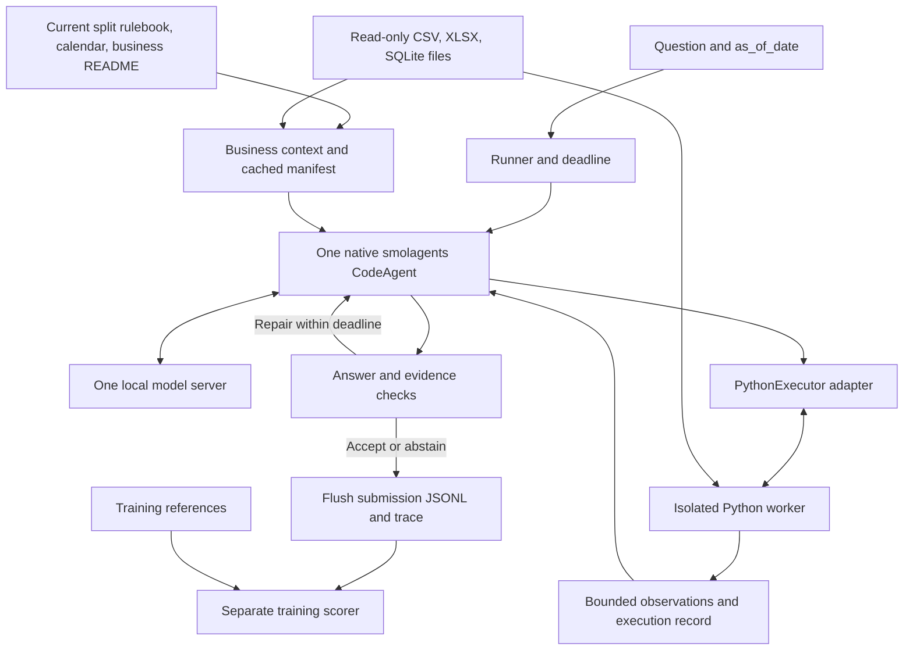

# Native smolagents rewrite plan

For a plain-language explanation with diagrams, a worked example, and debugging entry points, read [Understanding and debugging the agent](agent-walkthrough.md).

Status: native core implemented, 3 November 2026. The user requested starting the new code without running the old controller, then prioritized readability and maintainability. A recoverable source snapshot was saved at `runs/snapshots/20261103T095404Z`; the old environment remains in `.venv`. The CLI now uses native CodeAgent, a persistent isolated CPython worker, strict final checks, and expandable local traces. The original design and gates below remain a reference; broad quality and deployment claims are not established by this first slice.

Implementation scope update: the baseline-measurement portion of milestone 0a was skipped at the user's explicit request. Deterministic parsing helpers, the internal scorer, and business partitions were retained independently of the replaced controller. No old-agent benchmark was run, and no accuracy improvement over it is claimed. Python 3.12 dependencies now use `pyproject.toml`, `uv.lock`, and `.venv-native`. See [README.md](README.md) for current commands and verification boundaries.

Branch: `refactor/smolagents-rewrite`, created from local `main`. Uncommitted source was included in the recoverable snapshot before replacement. No commit, push, reset, or history rewrite is part of this work.

## 1. Recommended direction

Build one native `smolagents.CodeAgent` that reads the current business documentation, writes Python, executes it in an isolated worker, observes results, and returns a typed answer. Let smolagents own the agent loop, conversation memory, action parsing, and repair steps. Keep application code focused on data access, business-rule grounding, execution isolation, output contracts, and evaluation.

This replaces the previous custom controller and experimental wrapper together. The archived `smol_agent.py` used `ToolCallingAgent`, translated old JSON actions through `_ModelAdapter`, and imported the previous `Agent`. The replacement has no such adapter or controller inheritance.

The target is better Penalized Accuracy (PA) with useful coverage under the runtime budget. Less framework code and fewer model calls are engineering goals, not evidence of improved answers. Hugging Face documents code actions and recommends simplifying workflows and reducing unnecessary model calls. [Agent API](https://huggingface.co/docs/smolagents/v1.26.0/en/reference/agents), [agent-building guidance](https://huggingface.co/docs/smolagents/v1.26.0/en/tutorials/building_good_agents).

## 2. Evidence collected during planning

- Training contains 3,000 questions across 30 businesses, with 107 XLSX files, 20 CSV files, and one SQLite file. Public test contains 1,000 questions across 14 businesses, with 69 XLSX files, 10 CSV files, and one SQLite file. These are current metadata counts, not measured workloads; reference answers were not read for this plan.
- Representative training documentation shows both flat CSV exports and Excel workbooks split into monthly sheets. Files can require explicit header detection, per-sheet year interpretation, and product-specific unit conversion. A CSV-only or SQL-only rewrite would leave important ingestion work unresolved.
- The split rulebooks differ. Public rules add definitions such as customer loyalty by distinct purchase days and primary supplier by receipt count. Revenue, debt, inventory, and repair-shop activity also have different eligibility rules.
- The existing README records tiny local runs with substantial abstention. Those historical runs are insufficient to rank models or predict the rewrite's quality. They do show why formatting tests alone cannot be the acceptance criterion.
- This workstation currently reports an RTX 4050 Laptop GPU with 6,141 MiB VRAM, Python 3.14.4, and installed bubblewrap. The environment has smolagents 1.26.0 but lacks its optional `openai` package. A native local-server integration therefore needs a freshly resolved environment.

Use the offline reference profile in [project-overview.md](project-overview.md) as the provisional target: at most 15B total inference parameters, eligible weights released before 1 October 2026, read-only `/data`, outputs in `/result`, and six hours including model loading on the stated reference hardware. The current organizer regulations and separate Docker guideline were not independently verified in this task; packaging and reference-machine compliance remain open.

## 3. Technology choices

| Layer | Proposed choice | Reason and boundary |
| --- | --- | --- |
| Agent framework | `smolagents[openai]==1.26.0`, one `CodeAgent` | Native Python actions; no second orchestration framework or legacy action protocol. Version pinned because the API is experimental. |
| Model connection | Native `OpenAIModel` pointed explicitly at loopback | Same interface for local inference servers. The class name describes the protocol; inference uses local weights. Disable environment proxies, redirects, external endpoints, and automatic retry backoff in the offline configuration. |
| Workstation inference | Provisioned `llama.cpp` server and the existing quantized 7B code model | Practical starting point on the current 6 GB GPU. Offload and context settings must be measured; do not assume the whole model plus KV cache fits in VRAM. |
| Reference-machine inference | Evaluate a pinned CUDA-compatible vLLM build against llama.cpp | Candidate for batching concurrent questions on larger hardware. Choose by measured PA, throughput, memory, and offline compatibility. |
| Data computation | pandas 2.3.3, openpyxl 3.1.5, standard-library `sqlite3` and `decimal` initially | Covers the actual formats and irregular transformations. Explicit parsing and decimal arithmetic support exact outputs. Avoid a pandas major-version migration during the agent rewrite. |
| Contracts | Pydantic 2 in strict mode, with application validators | Discriminated answer types and a small internal calculation record. Do not silently coerce numeric strings or booleans into numbers. |
| Code execution | A small `PythonExecutor` adapter backed by a persistent bubblewrap worker | Keeps smolagents in charge while generated code runs outside the host process. No nested Docker daemon required for the proposed runtime. |
| Environment | `pyproject.toml`, `uv.lock`, proposed Python 3.12 for the packaged runtime | Separate the lightweight agent dependencies from model-serving dependencies. Resolve and test the exact versions during the compatibility milestone; the current Python 3.14 environment is not proof of that runtime. |
| Interface and artifacts | CLI, `predict.sh`, JSONL predictions and local JSON traces | Maintain straightforward benchmark/prediction commands and incremental results. |
| Verification | pytest with synthetic fixtures, then real-model training validation | Distinguish code correctness, isolation behavior, and model quality. |

The verified framework documentation and installed source use `OpenAIModel`; avoid copying older `OpenAIServerModel` examples. Install only the required extra. [Model API](https://huggingface.co/docs/smolagents/v1.26.0/en/reference/models), [dependency declaration](https://github.com/huggingface/smolagents/blob/v1.26.0/pyproject.toml). Both serving candidates document compatible chat-completion interfaces. [llama.cpp server](https://github.com/ggml-org/llama.cpp/blob/master/tools/server/README.md), [vLLM serving](https://docs.vllm.ai/en/stable/serving/online_serving/). Strict-mode behavior is documented by [Pydantic](https://docs.pydantic.dev/latest/concepts/strict_mode/).

### Model selection

Start development with `Qwen2.5-Coder-7B-Instruct` to compare against the already provisioned baseline. Evaluate `Qwen2.5-Coder-14B-Instruct` as a larger candidate when suitable hardware is available. Official cards list 7.61B and 14.7B total parameters respectively, both under Apache 2.0; the family announcement predates the reference cutoff. This establishes candidate metadata, not Vietnamese task accuracy or a winning model. [7B card](https://huggingface.co/Qwen/Qwen2.5-Coder-7B-Instruct), [14B card](https://huggingface.co/Qwen/Qwen2.5-Coder-14B-Instruct), [release announcement](https://qwenlm.github.io/blog/qwen2.5-coder-family/).

Each candidate is a separate experiment. A final offline configuration uses one selected model, reused for every reasoning and repair step. Do not deploy 7B plus 14B fallback together: their combined parameters exceed the provisional 15B budget even if loaded sequentially. Record the exact weight revision, source, digest, licence, total parameter count, quantization, runtime build, and generation settings before adoption.

## 4. Architecture



The runner and model client remain outside the generated-code worker. Only the runner can write submissions. The scorer is a separate command/process that opens training references after prediction; references are absent from both agent context and worker mounts.

### What smolagents owns

Use its normal `CodeAgent.run()`, native Python actions, memory, `final_answer()`, step callbacks, and `final_answer_checks`. Start without separate periodic planning calls; require a concise calculation outline in the first analysis action. Validate output through framework hooks and revalidate at the runner boundary. No custom inspect/plan/verify/review state machine.

### Guard incomplete model responses before execution

Preserve the current controller's rejection of `finish_reason="length"`. A synthetic probe against installed smolagents 1.26.0 confirmed that native CodeAgent can append the closing code tag and dispatch a syntactically valid prefix of a truncated response. Final-answer validation cannot prevent that earlier execution. [Pinned agent implementation](https://github.com/huggingface/smolagents/blob/v1.26.0/src/smolagents/agents.py).

Retain completion metadata from `OpenAIModel` and gate dispatch to the worker. A token-limit response must execute no code, even when its text parses or contains `final_answer()`. Surface a recoverable step observation asking for a shorter complete action; the retry consumes the existing step and question/run time budgets. Exhaustion produces `abstain`. Use a small integration hook that leaves retries in the native loop; the compatibility probe must show that rejection reaches the repair loop rather than becoming a fatal model-generation error. Start with non-streaming generation so completion status is known before any code is dispatched.

Acceptance checks must cover a valid-looking truncated prefix, a truncated response containing a final answer, a successful shorter retry, and repeated truncation until the budget is exhausted. Assert zero code dispatches to the worker for each rejected response, unchanged worker state, and bounded model calls. A normal completed response must still execute.

### What the application owns

1. **Dataset context:** load the mounted split's full rulebook, current business README, calendar, and a bounded file/sheet/table manifest. Give files stable aliases; preserve original names and provenance. IDs handle routing and association only.
2. **A few data tools:** `inspect_table(...)` for bounded previews and schema details, `read_table(...)` for full selected tables/sheets, and `table_profile(...)` for actual coverage and parse diagnostics. Their implementations run inside the isolated worker. Small library helpers handle explicit numeric/date parsing, checked joins, and rounding; no tool silently chooses business semantics.
3. **Execution:** implement the framework's `PythonExecutor` interface and return its `CodeOutput` structure. The initial compatibility milestone decides whether the framework's restricted interpreter covers required pandas operations inside the worker or a standard CPython backend is necessary. Either backend stays behind the same adapter and uses the native agent loop. [Executor interface](https://github.com/huggingface/smolagents/blob/v1.26.0/src/smolagents/local_python_executor.py).
4. **Finalization:** check the typed result and a compact calculation record containing sources, metric, period, grain, rule references, units, and diagnostics. Only submission fields leave this layer; internal evidence remains in logs.

Worker communication uses bounded JSON messages, never untrusted pickle. Intermediate DataFrames stay in the worker; only bounded summaries, execution metadata, and JSON-compatible final values cross the boundary. Tool registration resolves an allowlist of trusted implementations inside the worker; do not deserialize arbitrary host functions or execute generated code on the parent process. Preserve variables and DataFrames between successful steps of one question, subject to the recovery policy below, then destroy the worker before the next question.

The sandbox mounts only the current business, calendar, required runtime, and trusted helper code. Input mounts are read-only; scratch is private; network access is disabled. Apply wall-clock, CPU, memory, file-size, output, and process limits, and kill descendants on cancellation. The framework's import restrictions alone are not an operating-system security boundary. Bubblewrap depends on kernel/runtime permissions, so compatibility inside the final evaluator container is an early acceptance gate, with no unsafe execution fallback. [Execution guidance](https://huggingface.co/docs/smolagents/en/tutorials/secure_code_execution), [bubblewrap project](https://github.com/containers/bubblewrap).

### Worker recovery policy

A failed action is not a transaction rollback. The review probe changed `amount` from 100 to 200, raised an exception, and observed 200 still present in the restricted executor's state. Standard CPython also requires an explicit recovery policy for mutations made before an exception.

| Event | Required recovery |
| --- | --- |
| Truncated response or parsing failure rejected before dispatch | Keep the last successful worker state; report that no code ran and request a corrected action. |
| Worker-reported execution error, including an exception after an in-place DataFrame mutation | Kill the worker and descendants, discard its scratch state, and invalidate pending candidates and calculation records. If budget remains, create a fresh isolated worker containing only trusted initial variables and helpers. Tell the agent explicitly that all computed variables were lost and that it must reload sources and recompute. |
| Timeout, resource-limit termination, unexpected process exit, or invalid worker protocol response | End this question with `abstain`, clean up the worker and descendants, and preserve already flushed results. The next question starts with a fresh worker. |

Do not automatically replay failed actions or restore computed variables from conversation history. Tag execution records with a runner-owned worker generation; after reset, a substantive answer requires a new successful computation and matching evidence from the current generation. An `unanswerable` claim needs fresh absence diagnostics from that generation; `abstain` remains available without computation. Earlier observations remain in the trace with their reset boundary, but cannot validate a stale candidate. Recovery and worker startup consume the original budgets. A final-answer validation rejection after successful execution can use the existing repair path without treating that execution as a worker failure.

Acceptance checks must include a mutation followed by an exception and retry, rejection of a candidate from the old worker generation, timeout cleanup of descendants, and isolation between successive questions. Verify that reloading and applying a unit conversion once after reset produces the expected synthetic result without applying it twice.

## 5. Data flow for one question

Example: “Which product sold the most last week?”

1. **Route:** the runner selects the business directory and the mounted split's rules/calendar. It passes the question and `as_of_date`, keeping association IDs outside the reasoning prompt.
2. **Ground:** reuse the business manifest, README, full rulebook, file aliases, and header candidates. Provide small samples; never put entire transaction tables in the prompt.
3. **Interpret:** the agent identifies quantity in base units as the default ranking metric and resolves the previous Monday–Sunday interval against `as_of_date`. It identifies the order and line grains, relevant status fields, and conversion source. Explicit question instructions override defaults.
4. **Read:** load every relevant sheet/table, not only the preview or first Excel sheet. Retain sheet/year/row provenance. Ambiguous headers, encodings, decimal separators, or date conventions require inspection rather than guesses.
5. **Compute:** apply the current rules, exclude whole cancelled/returned orders where required, convert units, aggregate by product identity, and rank with the documented tie-break. Run over all applicable rows.
6. **Check:** confirm date coverage, unit mapping, join cardinality and unmatched keys, selected row counts, and result type. Use a second aggregation or targeted assertion where it can expose a specific error; do not require another model review for every answer.
7. **Finalize:** call `final_answer()` with the typed answer and internal calculation record. Validation failure becomes a useful repair observation within the remaining budget.
8. **Persist:** the runner strips evidence, attaches the original question ID, validates again, appends one JSONL result, and flushes it. Record elapsed time, code actions, observations, model usage, and failure reason separately.

This is a generic example derived from the rulebook, not a computed answer to a test question.

### Detailed execution sequence

This diagram describes the proposed implementation. Calls between components show responsibility boundaries; the reasoning and repair loop remains owned by CodeAgent. The run deadline starts before model loading and preprocessing, and every retry uses the remaining budget.

```mermaid
sequenceDiagram
    autonumber
    participant R as Runner and context loader
    participant A as Native CodeAgent
    participant M as Local model server
    participant E as Executor adapter
    participant W as Isolated worker
    participant D as Read-only split data
    participant O as Results and traces
    participant S as Separate training scorer

    R->>R: Start total deadline and reserve output/shutdown time
    R->>M: Start provisioned local model and check readiness
    R->>D: Read questions and current split rules/calendar
    D-->>R: Questions, rulebook, calendar
    R->>O: Save selected-question manifest and run configuration

    loop Each selected question while run budget remains
        R->>D: Read business README and inspect bounded metadata
        D-->>R: File/sheet/table manifest, aliases, header candidates
        R->>R: Reuse valid metadata cache and allocate question deadline
        R->>E: Open question session with limits and trusted initial variables
        E->>W: Start worker generation g with private scratch
        Note over W,D: Mount only current business, calendar, and trusted runtime/helpers.<br/>Inputs are read-only; network is disabled; references are absent.
        R->>A: run(question, as_of_date, full rules, README, manifest)
        Note over R,A: Keep association IDs in the runner.<br/>Start fresh question memory and execution state.

        loop Until accepted answer, terminal failure, or exhausted budget
            A->>A: Check remaining steps/time and prepare bounded context
            A->>M: Generate next native Python action
            M-->>A: Response text, completion status, token usage

            alt Truncated response or parsing failure before dispatch
                A->>A: Reject action and add bounded repair observation
                Note over A,W: No code reaches the worker; last successful state remains.<br/>The next generation consumes the same question/run budgets.
            else Complete, parseable action
                A->>E: Submit Python action under remaining limits
                E->>W: Execute action through bounded JSON protocol
                opt Action needs source data
                    W->>D: Inspect or read relevant CSV/XLSX/SQLite sources
                    D-->>W: Selected tables/sheets and provenance
                end

                alt Execution succeeds
                    W-->>E: Bounded logs, result/final flag, calculation diagnostics
                    E-->>A: CodeOutput and record tagged with generation g
                    alt Action calls final_answer()
                        A->>A: Run final_answer_checks on type and evidence
                        alt Checks pass
                            A->>A: Accept candidate and end native loop
                        else Checks fail
                            A->>A: Add repair observation within remaining budget
                        end
                    else Intermediate inspection or calculation
                        A->>A: Add observation to native memory
                        Note over A,W: DataFrames stay in the worker for the next successful step.
                    end

                else Worker reports an execution error
                    W-->>E: Error and bounded diagnostics
                    E->>W: Kill worker/descendants and discard scratch state
                    E->>E: Invalidate pending candidates and evidence from g
                    alt Budget permits recovery
                        E->>W: Start generation g+1 with trusted initial state only
                        E-->>A: State reset; reload sources and recompute
                        Note over A,W: No automatic replay or restoration of computed variables.<br/>Old observations cannot validate a new candidate.
                    else No recovery budget
                        E-->>A: Terminal failure; end question with abstain
                    end

                else Timeout, resource termination, crash, or invalid protocol
                    Note over E,W: Adapter detects failure or missing response independently.
                    E->>W: Kill worker and descendants; discard scratch
                    E-->>A: Terminal failure; end question with abstain
                end
            end
        end

        opt Step or wall-clock budget exhausted without accepted answer
            A->>A: Produce abstain without fallback model generation
        end
        A-->>R: Accepted typed candidate or abstain, plus execution trace
        R->>R: Revalidate answer and current-generation evidence
        alt Runner validation passes
            R->>R: Strip internal evidence and attach original question ID
        else Runner validation fails
            R->>R: Replace candidate with abstain and record failure reason
        end
        R->>O: Append and flush submission row; save trace and elapsed time
        R->>E: Close question session
        E->>W: Ensure worker/descendants are gone before next question
    end

    R->>M: Shut down model server started for this run
    R->>O: Finalize completion/partial-run report within reserved time
    opt Separate training evaluation after inference
        S->>O: Read frozen question manifest and prediction files
        O-->>S: Questions and predictions
        S->>S: Open training references and apply pinned evaluator
        S->>O: Write PA, coverage, answered accuracy, and failure breakdown
    end
```

The sequence has five parts:

1. **Prepare the run and ground the question.** The runner starts the deadline before loading the local model, loads the mounted split's rules, and resolves the business files. It supplies the full rulebook, README, bounded manifest, question, and `as_of_date` to a fresh question session. Cached metadata must match the current inputs.
2. **Generate, execute, and observe.** CodeAgent asks the same local model for each action. The completion guard rejects truncated output before execution. Valid Python runs only in the isolated worker, where tables can remain between successful actions. Only bounded observations and JSON-compatible results return to the agent.
3. **Recover with explicit state boundaries.** A response rejected before execution leaves worker state intact. An execution exception destroys that state; recovery creates a new generation and requires reloading and recomputation. Timeout, resource termination, process failure, or invalid protocol ends the question with `abstain`. The parent enforces deadlines during active work, not only between steps.
4. **Validate and persist.** Framework hooks check a candidate before accepting it, and the runner validates again before writing. Substantive answers require current-generation computation evidence; `unanswerable` requires current-generation absence diagnostics; `abstain` needs no computation. Only the runner attaches the original ID and writes the submission. It flushes each completed row so a later interruption preserves earlier results, then closes the worker session.
5. **Score separately.** Prediction runs stop after writing outputs. Training evaluation opens references in a separate process after inference and uses the frozen evaluator for both old and new predictions. References never enter the agent prompt or worker mounts. The diagram's validation steps check observable contracts; semantic accuracy still requires the real-model evaluation milestones.

### Semantic requirements that must survive the rewrite

| Risk | Required behavior |
| --- | --- |
| Wrong time window | Anchor relative dates to `as_of_date`; distinguish period flows from end-of-day balances; use `calendar.csv` for lunar windows. |
| Incorrect order eligibility | Bind filters to the requested measure. Returned orders excluded from revenue can still contribute debt. |
| Spreadsheet export artifacts | Forward-fill only identified group fields within proven boundaries. Deduplicate same-order export duplicates only where the current rules allow it; keep independent ledger events. |
| Wrong cost or units | Read conversion factors from this business's data/README. Gross profit uses recorded sales-line cost under the inspected rules; do not reconstruct it from purchase lots. |
| Join multiplication | Require explicit join keys and cardinality; report unmatched/null keys and row expansion. pandas `validate=` and `indicator=` support these checks. [Merge API](https://pandas.pydata.org/docs/reference/api/pandas.merge.html). |
| Empty selection | Distinguish no matching activity within coverage from a period wholly outside coverage. Inspect date/entity parsing before claiming absence. |
| Wrong output | Enforce all nine answer types, whole-currency rounding, percentage units, finite numbers, ISO dates, ordered lists, and table shape. Preserve Vietnamese diacritics. |
| Unsupported answer | Use `unanswerable` only when inspected sources establish missing information or required coverage. Unresolved parsing, failed execution, timeout, or uncertainty becomes `abstain`. |

Reader instrumentation can establish which sources were opened and their observed coverage. Assertions and calculation records produced by agent code remain claims, not independent proof of business correctness. Targeted checks reduce detectable mistakes; real held-out evaluation remains necessary.

## 6. Efficiency strategy and initial budgets

- **Cache metadata once per business.** Key caches by source, README, rulebook, calendar, reader version, and parsing options. Metadata caches contain no previous answers or reasoning. Keep per-question execution state separate.
- **Keep DataFrames between successful steps.** Reuse loaded data while the worker remains healthy, including after responses rejected before execution. Worker execution errors trigger the reset policy above. Load only relevant sheets; never prune a sheet solely because its name looks irrelevant when coverage is uncertain.
- **Start with pandas.** SQL tools can read the existing SQLite input directly. Add DuckDB or a trusted read-only Parquet cache only if profiling shows repeated ingestion or aggregation dominates runtime; they are not initial dependencies.
- **Keep prompts bounded.** Reuse a stable instructions/rulebook prefix, then append business context and the question. Summarize tool output, not the active rulebook. Check token capacity before starting and reserve room for code and repairs.
- **Use one short path.** Aim for inspect, compute/check, and finalize in a few native actions. Avoid mandatory separate planning, recomputation, and review calls. This is a target to measure, not a guaranteed action count.
- **Bound all work.** Proposed starting configuration: 8 action steps, 2,048 output tokens per model call, 30 seconds per code action, 180 seconds per question, and one worker/question initially. Repairs consume the same step/time budget. Tune these values on development businesses.
- **Enforce a total deadline.** Include preprocessing, model startup, retries, and shutdown. For the provisional six-hour profile, reserve output/shutdown time and adapt per-question allowances to the remaining run budget. Per-question timeouts alone cannot ensure a full run fits.
- **Handle framework exhaustion deliberately.** Installed 1.26.0 source shows an extra generated fallback after the step cap, outside the ordinary final-answer checks. Reject `max_steps_error` results, prevent an unbudgeted fallback generation through a minimal framework hook, and emit `abstain`. Keep this behavior covered by a regression test.
- **Scale only after a serial baseline.** Measure 2 and 4 concurrent independent questions on suitable hardware, sharing one model server and keeping isolated workers. Cap CPU reader threads; record the effect on latency, memory, total time, and repeatability.

If 500 questions share six hours, the simple serial average allowance is 43.2 seconds before startup and other overhead. That arithmetic is a planning bound, not a throughput claim; actual question count, workload mix, and hardware require measurement.

## 7. Fresh implementation layout and removal scope

```text
tabular_agent/
  agent.py          # Native CodeAgent construction, instructions, hooks
  data.py           # Split loader, manifests, explicit readers
  tools.py          # Small tool registry and parsing/checking helpers
  executor.py       # PythonExecutor adapter and worker lifecycle
  worker.py         # Isolated execution session
  contracts.py      # Strict answers and calculation records
  runner.py         # CLI, configuration, deadlines, outputs
  evaluate.py       # Training-only scoring and business partitions
tests/              # New behavioral and isolation tests
pyproject.toml
uv.lock
Makefile
predict.sh
Dockerfile          # Added after the packaging contract is verified
```

After the baseline-preservation and compatibility gates pass, rewrite the existing package, tests, launch/comparison scripts, runtime entrypoint, dependency declarations, and Make targets for this design. Remove the legacy custom loop, JSON-action model adapter, duplicate controller state, mandatory review protocol, and unsupported calibration plumbing. Rebuild required scoring and parsing behavior from their documented contracts and regression cases; the evaluator must pass the comparison contract below before adoption. Do not carry the old implementation through inheritance or an optional legacy mode.

Keep project instructions, source requirements, design history, Git metadata, datasets, weights, credentials, and existing result artifacts. Before deleting any current implementation, save a recoverable local snapshot of tracked changes plus untracked source files, outside the replacement source tree; protect any sensitive contents. A branch reference by itself does not save uncommitted work. No commit, push, reset, or history rewrite is part of this plan.

## 8. Ordered milestones and acceptance gates

### Frozen baseline and scoring contract

Before replacing source/tests or changing the baseline environment, preserve the current custom controller, its transitive scorer/validator dependencies, regression cases, dependency lock and runtime metadata in the recoverable local snapshot. Freeze the existing business partitions and a question manifest of at least 100 validation questions, plus a separate development smoke sample. Record source, input, rulebook, manifest, scorer and weight hashes, quantization, backend build, hardware, generation settings, budgets, and seeds. Keep artifacts containing real data Git-ignored and outside agent context and worker mounts.

Run the old controller on the frozen smoke sample and then the validation manifest; save predictions, traces, configuration and reports before the replacement begins. Record timeouts and abstentions as outcomes. Do not substitute the historical tiny runs for this baseline. If the model cannot be provisioned, keep this gate incomplete and preserve the existing runnable source/environment; independent compatibility probes may continue in a separate environment, but source replacement waits.

Score both old and new prediction files using one pinned internal evaluator and its frozen validation/matching dependencies. A changed scorer cannot be used only on the new output. Cover all nine answer types, numeric tolerance and rounding, aliases and Vietnamese normalization, list order, table column mapping/row-set matching, invalid predictions, missing answers, and duplicate/unknown IDs with retained expected-result fixtures. Require the rewritten evaluator to match the frozen evaluator on those fixtures and both prediction files before adoption. Preserve the existing documented uncertainties about official matching behavior.

If an evaluator defect is established against the applicable requirements, document it as a separate change, update its expected-result fixtures, and rescore both prediction files with the same corrected version. Report the score change caused by the evaluator separately from the agent comparison. The frozen evaluator is a local measurement artifact and is not imported by the replacement inference path.

| Milestone | Deliverable | Gate before proceeding |
| --- | --- | --- |
| 0a. Preserve and measure baseline | Recoverable source/environment snapshot, frozen question manifests and evaluator, old-controller predictions and run metadata | Complete the frozen baseline/scoring contract before replacing source/tests or changing the baseline environment. Preserve existing partition membership. |
| 0b. Compatibility | Separate fresh dependency lock; native CodeAgent/local-server spike; executor and container probe | Synthetic CSV/XLSX/SQLite calculations work, successful-step state persists, truncated responses never execute, failure recovery invalidates old state/evidence, strict final validation works, and read-only/network/resource boundaries are demonstrated. Resolve executor choice before removing the old code. |
| 1. Fresh core | Replace the package with the modules above and rebuild `bench`, `predict`, `test`, and `test-sandbox` commands | Gates 0a and 0b pass; native agent path has no imports from the old controller. Scripted-model end-to-end tests prove bounded truncation repair, worker reset/recomputation, incremental writes, cancellation, and abstention. |
| 2. Data and rules | Explicit readers, provenance, business manifests, calculation diagnostics | Synthetic regressions cover BOM/headers, monthly sheets, missing years, numeric locales, grouped blanks, duplicate policy, order-vs-line counting, returns, joins, units, rounding, and coverage. |
| 3. Paired real-model evaluation | New predictions on the frozen manifests, compared with milestone 0a | Run the frozen development smoke sample, then the same validation manifest of at least 100 questions. Score both outputs with the pinned evaluator; require rewritten-scorer parity before adoption. Report PA, coverage, answered accuracy, invalid output, unanswerable errors, latency, total time, and failure categories. Size is a starting measurement proposal, not statistical sufficiency. |
| 4. Measured optimization | Chosen model/backend, action budget, cache, and concurrency | Keep a change only when validation supports its PA/runtime trade-off. Compare quantizations separately. Fit any selective-answer policy on a calibration subset of training businesses; do not use the same labels for fitting and unbiased reporting. |
| 5. Freeze and package | Locked source/model/runtime, offline image and run manifest | Evaluate once on untouched business holdout; run the full offline workload with read-only input and networking disabled; repeat the frozen run and compare outputs, PA, time, and memory. Reference hardware remains a separate verification requirement. |

Preserve the existing business partition membership and seed rather than reshuffling previously inspected businesses into holdout. Use training references only in the scorer. Compare old and new agents with identical question manifests, source data, rulebooks, weight/quantization settings, serving configuration, hardware, generation settings, and budgets, using the same pinned evaluator. Record intentional framework/runtime dependency differences. Any necessary change to the shared comparison settings requires a matched baseline rerun from the preserved environment. Public/private test references are never development inputs.

A useful replacement must improve validation PA with useful coverage and fit measured resource limits. An all-abstain run, passing synthetic tests, or a smaller source tree does not establish success. A positive score delta on a small sample also needs per-business inspection before treating it as general improvement.

## 9. Planning verification record, before implementation

Completed for this draft: inspected Git state, current code structure and partial integration, project requirements, both split rulebooks, representative training READMEs, dataset metadata counts, local GPU/runtime availability, installed framework source, and official framework/model/serving documentation. Created the requested branch and this plan.

Review evidence: two inline synthetic probes against installed smolagents 1.26.0 confirmed dispatch of a valid code prefix marked `finish_reason="length"` and retention of a mutated variable after an execution exception. The truncation probe used a scripted model and a recording executor; the state probe used trusted synthetic code in the local restricted interpreter. Neither probe exercised the proposed bubblewrap adapter or measured model quality. The recovery policies and acceptance checks added in this revision remain proposed and unimplemented.

Not performed: baseline capture/benchmark, deletion of source, implementation of the replacement, dependency installation, real model calls, container execution, or reference-hardware validation. The unresolved engineering questions are executor compatibility inside the eventual image, model quality on Vietnamese business questions, and achievable full-run throughput. Milestones 0b, 3, and 5 resolve those questions respectively; milestone 0a establishes the baseline before replacement.

## 10. Implementation verification — 3 November 2026

The native CLI path, isolated persistent CPython executor, strict calculation records, completion guard, worker reset policy, and expandable local HTML traces are implemented. The earlier custom controller, action adapter, calibration plumbing, and obsolete tests/scripts are recoverable from the source snapshot. The independent scorer, contracts, explicit parsing helpers, and partition membership logic were retained unchanged. Source replacement proceeded under the user's explicit instruction to skip an old-agent run.

`make test-sandbox` passed 36 checks with actual bubblewrap isolation on this host. These include cross-month synthetic calculations, persistent DataFrames, no execution of truncated responses, step exhaustion without fallback generation, validation repair, reset/recomputation after mutation, rejection of old candidates, read-only inputs, no reference mounts, blocked host network access, malformed protocol handling, resource limits, descendant cleanup, and preserved results after interruption. `make check`, shell syntax, documentation links, and retained-component digests passed their checks.

A completed real-model demo using the provisioned 7B Q4_K_M candidate, full GPU offload, a 16K context, and Q8 key/value cache produced 1 correct, 2 wrong, and 0 abstentions over three invented questions; internal PA −0.3333, CLI time 138.124 seconds excluding prior server startup. The exact product match did not read both monthly sheets. The quantity case repeated a CSV numeric string, and the profit case invented an unsupported numeric result. The semantic acceptance gate remains unmet; this is not evidence of a framework accuracy gain. See `runs/demo-output-20261103-172651-636584/trace.html` and `report.json` for the evidence.

Untouched business holdout, representative training validation, full-run throughput, complete offline packaging, nested isolation in the evaluator image, and reference-hardware compliance remain unverified. No commit, push, or submission was created.
